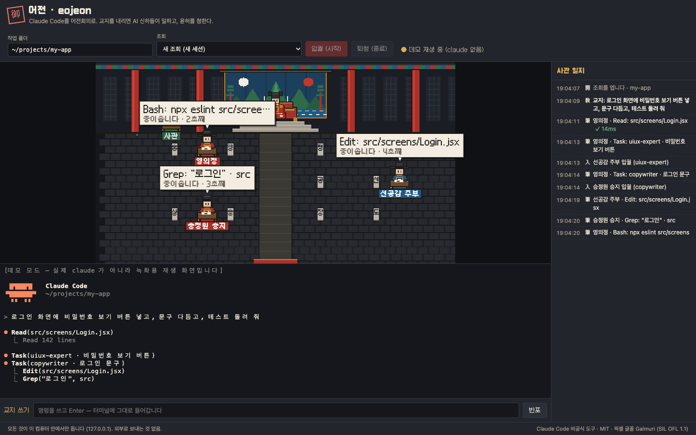
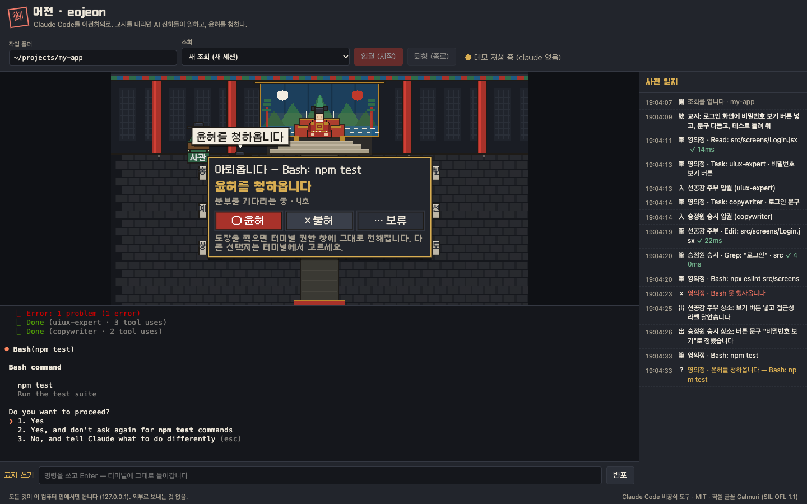

# 어전 · eojeon

<p align="center"></p>

**Claude Code를 어전회의로. 교지를 내리면 AI 신하들이 일하고, 윤허를 청한다.**

브라우저에 픽셀 아트 조선 궁궐(어전)과 **내 Claude Code 터미널**을 함께 띄우는 로컬 웹 앱입니다.
사용자는 임금, 명령은 **교지**, 권한 승인은 **윤허**, 결과 보고는 **상소**입니다. Claude Code 본체는 영의정, 서브에이전트는 각 관청의 신하로 나타납니다.

> Claude Code 비공식 도구입니다. Anthropic 과 관계가 없습니다. *Unofficial — not affiliated with Anthropic.*





[English below](#english)

## 설치 (세 가지 중 하나)

**1. npx (가장 쉬움)**

```bash
npx eojeon            # http://localhost:4747 이 열립니다
npx eojeon demo       # claude 없이 녹화된 장면 재생 (사용량 0)
npx eojeon init       # 지금 폴더에 육조 신하 6명 들이기
```

**2. Claude Code 플러그인**

Claude Code 안에서:

```
/plugin marketplace add hiio420pr/eojeon
/plugin install eojeon@eojeon
```

(Claude Code 2.1.275 이상은 한 줄로: `/plugin install eojeon --marketplace hiio420pr/eojeon`)

그다음 `/eojeon` 또는 "어전 열어줘" 라고 하면 Claude 가 `npx -y eojeon@latest` 를 백그라운드로 띄우고 주소를 알려 줍니다(어전 본체는 늘 최신 npm 버전). 이미 떠 있으면 그대로 씁니다. 플러그인에는 육조 6명이 `eojeon:ijo` … `eojeon:gongjo` 로 들어 있습니다.

**업데이트 받기 (플러그인):** 우리가 만든 마켓은 자동 업데이트가 기본으로 꺼져 있습니다. `/plugin` → Marketplaces → eojeon → **Enable auto-update** 를 한 번 켜 두세요. 직접 받으려면 `/plugin marketplace update eojeon`. 새 버전은 다음 세션(또는 `/reload-plugins`)부터 적용됩니다.

**npx 와 플러그인 둘 다 설치할 필요는 없습니다.** 플러그인은 속에서 `npx eojeon` 을 대신 실행합니다. 플러그인을 쓰면 `npx eojeon init` 은 하지 마세요(육조가 두 벌 생김).

**3. git clone**

```bash
git clone https://github.com/hiio420pr/eojeon.git
cd eojeon
npm install
npm start          # = node cli/eojeon.js
```

### 명령

| 명령 | 하는 일 |
|---|---|
| `eojeon` | 서버를 켜고 브라우저를 엽니다 |
| `eojeon demo` | claude 없이 녹화된 장면을 반복 재생 (`?demo=1&stop=15` 처럼 특정 순간에서 멈춤) |
| `eojeon init [폴더] [--pack yukjo\|studio\|all]` | `<폴더>/.claude/agents/` 에 신하 파일 복사. **같은 이름 파일이 있으면 덮어쓰지 않고 건너뜀** |
| `--port <n>` | 포트 (기본 4747, 사용 중이면 다음 빈 포트) |
| `--cwd <폴더>` | 시작 화면의 기본 작업 폴더 |
| `--no-open` | 브라우저를 열지 않음 |
| `--help`, `--version` | 도움말, 버전 |

`COURT_CLAUDE_BIN=/path/to/claude` 로 다른 claude 실행 파일을 쓸 수 있습니다.

## 육조 (기본 신하 6명)

`eojeon init`, 첫 실행 화면의 "육조를 들이시겠사옵니까?" 확인, 또는 플러그인으로 들어옵니다. 모두 Claude Code 서브에이전트 파일(`templates/agents/yukjo/*.md`)이고, 본문은 영어(첫 줄 한국어 요약), 권한은 일에 필요한 만큼만 줍니다.

| 관직 | 역할 | slug | 도구 |
|---|---|---|---|
| 이조판서 | 설계·계획: 일을 쪼개고 순서·담당·완료 기준을 정함 | `ijo` | 읽기 전용 |
| 호조판서 | 성능·비용·숫자: 측정 먼저, 숫자로 판단 | `hojo` | 읽기 + Bash |
| 예조판서 | 문서: README·주석·커밋 메시지·변경 기록 | `yejo` | 읽기 + Bash + 편집 |
| 병조판서 | 보안: 취약점(OWASP)·비밀 노출·권한 점검 | `byeongjo` | 읽기 전용 |
| 형조판서 | 코드 리뷰·버그 수사: 심각도 등급, 재현 단계 | `hyeongjo` | 읽기 + Bash |
| 공조판서 | 구현: 작은 단위로 코드 작성, 테스트 통과 | `gongjo` | 읽기 + Bash + 편집 |

모든 신하는 표 형식(열 고정)으로 보고하고, 끝에 `Next action`(다음 행동 1개)과 `Confidence`(확신도)를 붙입니다.

### 선택 팩 studio (11명)

1인 앱 개발자용 기획·디자인·홍보 팀입니다. `eojeon init --pack studio` (또는 `all`).

| 관직 | slug | 하는 일 |
|---|---|---|
| 홍문관 부제학 | `product-designer` | 기능 기획, 화면 흐름, 우선순위 |
| 산학 교수 | `data-analyst` | 숫자 해석, 실험 설계, 작은 숫자 과잉 해석 방지 |
| 예조 참판 | `pr-lead` | 출시 캠페인, 메시지 일관성, 위기 대응 |
| 승정원 승지 | `copywriter` | 스토어·앱 안 문구, 헤드라인 |
| 상서원 정 | `branding-expert` | 브랜드 정체성, 비주얼 시스템 |
| 평시서 령 | `marketer` | 채널, ASO, 성장 실험 |
| 찰방 | `sns-manager` | 채널별 원고, 게시 일정, 반응 집계 |
| 공조정랑 | `apple-designer` | Apple HIG·App Store 기준 |
| 선공감 주부 | `uiux-expert` | UI 점검과 수정 |
| 장악원 악사 | `animation-expert` | 모션 설계와 구현 |
| 도화서 화원 | `video-producer` | 숏폼·미리보기 영상 |

이미 가진 내 에이전트는 그대로 둡니다. 화면에서는 마당의 "관리 · <이름>"으로 섭니다. 관직·관복 색·자리는 `court.config.json` 의 `officials` 에서 바꿀 수 있습니다.

## 화면에서 일어나는 일

- **진짜 Claude Code 그대로**: 아래 터미널은 내 PC의 `claude` 를 PTY 로 띄운 것입니다. 슬래시 명령, 권한 창, `/resume`, 모델 전환 등 CLI 에서 되는 건 다 됩니다. 한글이 두 칸에 딱 맞도록 터미널 글꼴은 D2Coding 입니다.
- **시작 옵션**: 작업 폴더, 새 조회 / 이어서(`--continue`) / 지난 세션(`--resume <id>`), 권한 모드(`--permission-mode`: manual · acceptEdits · plan · auto · dontAsk — `bypassPermissions` 는 윤허 장면이 사라지고 위험해서 일부러 뺐습니다).
- **장면**: 교지 반포 → 임금이 두루마리를 듦 · 도구 사용 → 담당 신하가 붓질하며 말풍선 · 서브에이전트 시작 → 그 관직의 신하가 입궐해 자기 책상으로, 끝나면 영의정께 보고하고 퇴궐 · 권한 요청 → 오른쪽 위에 "윤허를 청하옵니다" 패널과 **윤허 / 불허 / 보류** 도장(터미널 권한 창에 실제 키 전송: 윤허=`1`, 불허=`Esc`) · 실패 → 먹물 얼룩 말풍선.
- 말풍선은 겹치지 않게 자리를 엇갈리고, 한 번에 3개까지만 보입니다. 나머지는 **사관 일지**(오른쪽)에 모두 남습니다.
- **교지 쓰기 입력창**: 한글 입력이 편한 별도 입력창. Enter 로 터미널에 그대로 들어갑니다.

## 작동 원리

1. 서버가 `node-pty` 로 `claude --settings <임시 settings.json>` 을 띄우고, WebSocket 으로 브라우저의 xterm.js 와 연결합니다.
2. 임시 settings 에는 **hooks 만** 들어 있습니다(SessionStart, UserPromptSubmit, PreToolUse, PostToolUse, PostToolUseFailure, PermissionRequest, PermissionDenied, SubagentStart, SubagentStop, Notification, Stop, StopFailure, SessionEnd). `~/.claude/settings.json` 은 건드리지 않고, 끝나면 임시 파일을 지웁니다.
3. 각 hook 은 `server/hook.js` 를 실행합니다. hook JSON 을 **짧은 표시용 이벤트로 줄인 뒤**(도구 이름, 명령 첫 줄, 상대 경로, 비밀 가림) `127.0.0.1` 서버로만 보냅니다. 1.5초 안에 끝나고, 아무것도 출력하지 않고, 항상 exit 0 — Claude Code 를 막거나 결정을 바꾸지 않습니다.
4. 브라우저가 이벤트를 받아 궁궐 장면과 사관 일지를 그립니다. 플러그인 에이전트(`eojeon:ijo` 처럼 이름 앞에 플러그인 이름이 붙은 것)도 같은 관직으로 찾습니다.

## 개인정보

- **로컬 전용**: 서버는 `127.0.0.1` 에만 열립니다. 외부로 보내는 요청이 없습니다. xterm 은 npm 패키지에서, 글꼴은 패키지 안에서 직접 서빙합니다(CDN 없음, 추적 없음).
- **비밀 가림**: 화면으로 가는 이벤트에는 파일 내용·도구 출력·전체 프롬프트가 없습니다. 프롬프트는 앞 60자, 명령은 첫 줄 56자까지, API 키·토큰·비밀번호·개인 키 모양 문자열은 `***` 로 가립니다.
- **외부 연결 차단**: Host·Origin 을 검사해 다른 웹사이트가 내 터미널에 입력하거나 에이전트 파일을 쓰지 못하게 막고(DNS rebinding·CSWSH 방어), hook 수신은 실행마다 새로 만든 토큰으로만 받습니다.
- 세션 목록은 `~/.claude/projects/` 기록 파일의 앞뒤만 읽기 전용으로 읽습니다.

## Windows

1. [Node.js LTS](https://nodejs.org) 설치 (20 이상 권장).
2. [Claude Code](https://code.claude.com/docs/en/setup) 설치·로그인 — Windows 에서는 [Git for Windows](https://git-scm.com/download/win) 가 함께 필요합니다. PowerShell 에서 `claude --version` 이 나오면 준비 끝.
3. PowerShell 에서 `npx eojeon` → 브라우저에 http://localhost:4747 이 열립니다.
4. 처음 실행 때 Windows 방화벽 창이 뜨면 '개인 네트워크'만 허용하면 됩니다(어전은 127.0.0.1 에서만 듣습니다).
5. 막히면: `claude` 를 못 찾는다 → 새 PowerShell 창을 열거나 Claude Code 설치 경로를 PATH 에 추가 / 4747 포트가 사용 중 → `npx eojeon --port 4800` / 한글이 깨진다 → 브라우저를 새로 고침(D2Coding 글꼴 로드 후 터미널이 열림).

Windows 는 아직 개발자가 직접 시험하지 못했습니다. 문제가 있으면 [이슈](https://github.com/hiio420pr/eojeon/issues)로 알려 주세요.

## 요구 사항

- Node.js 18 이상 (20 이상 권장)
- [Claude Code](https://code.claude.com) 설치·로그인 (`claude` 가 PATH 에 있어야 함). 데모는 없어도 됩니다.
- 터미널 모듈은 빌드 도구 없이 미리 빌드된 것을 씁니다.

| OS | 쓰는 모듈 | 빌드 도구 |
|---|---|---|
| macOS arm64 / x64 | `node-pty` 1.1.0 (패키지 안에 prebuild 포함) | 필요 없음 |
| Windows x64 / arm64 | `node-pty` 1.1.0 (prebuild 포함, ConPTY) | 필요 없음 · 아직 시험 전 |
| Linux x64 / arm64 (glibc·musl) | `@homebridge/node-pty-prebuilt-multiarch` 0.14.1 | 필요 없음 (Node 20+) · 아직 시험 전 |

둘 다 optionalDependencies 라서 설치가 실패해도 `eojeon demo` 는 동작합니다.

## 꾸미기 (court.config.json)

이름, 관직 대응(에이전트 종류 → 관직·관복 색·흉배 문양·자리), 임금 곤룡포 색, 팔레트, 도장 3종, 말투, 권한 버튼 키를 모두 바꿀 수 있습니다. 새로고침하면 반영됩니다. `seat` 가 없는 관직은 빈 책상을 차지하고, 책상이 없으면 마당에 섭니다.

## 그림에 대해

어좌·일월오봉도·품계석·관복은 모두 직접 그린 단순한 도형입니다. 국보 사진이나 실제 어보·옥새 문양을 따라 그리지 않았습니다. 임금은 특정 역사 인물을 닮지 않은 일반 캐릭터입니다.

## 개발

```bash
npm test               # 비밀 가림, init 덮어쓰기 금지, config 매핑, CLI
npm run fake-hooks     # npm start 가 떠 있을 때 가짜 hook 을 실제 hook 스크립트로 흘려보냄 (사용량 0)
npm run check-publish  # 패키지 파일에 로컬 경로·이메일·토큰이 없는지 + npm pack 목록
claude plugin validate .
```

## 영감

비슷한 생각을 한 프로젝트들입니다(코드는 가져오지 않았습니다): [pablodelucca/pixel-agents](https://github.com/pablodelucca/pixel-agents), [paulrobello/claude-office](https://github.com/paulrobello/claude-office), [YehudaLevi/pixelagents](https://github.com/YehudaLevi/pixelagents)

## 라이선스

- 코드: MIT ([LICENSE](LICENSE))
- 글꼴(패키지에 포함, 수정 없이 재배포): [Galmuri](https://github.com/quiple/galmuri) 2.40.3 — SIL OFL 1.1 ([public/fonts/LICENSE-Galmuri.txt](public/fonts/LICENSE-Galmuri.txt)) · [D2Coding](https://github.com/naver/d2codingfont) 1.4.0 — SIL OFL 1.1, © NAVER Corporation ([public/fonts/LICENSE-D2Coding.txt](public/fonts/LICENSE-D2Coding.txt))
- Claude Code 는 Anthropic 의 제품이며, 이 도구는 Anthropic 과 무관한 비공식 도구입니다.

---

## English

**eojeon** (어전, "the royal audience hall") turns Claude Code into a Joseon royal court. You are the king: your prompt is a royal decree, permission prompts become petitions for royal assent, and subagents walk in as court officials.

### Install (pick one)

1. **npx**: `npx eojeon` → http://localhost:4747 · `npx eojeon demo` (no claude, no usage) · `npx eojeon init` (add the Six Ministries to `./.claude/agents`)
2. **Claude Code plugin**: `/plugin marketplace add hiio420pr/eojeon` then `/plugin install eojeon@eojeon` (or on 2.1.275+: `/plugin install eojeon --marketplace hiio420pr/eojeon`). Then type `/eojeon` or "open the court". Third-party marketplaces don't auto-update by default: run `/plugin` → Marketplaces → eojeon → Enable auto-update (or `/plugin marketplace update eojeon`). You don't need both npx and the plugin. The plugin also provides the six agents as `eojeon:ijo` … `eojeon:gongjo`.
3. **git clone**: `git clone https://github.com/hiio420pr/eojeon.git && cd eojeon && npm install && npm start`

CLI: `eojeon [--port n] [--cwd dir] [--no-open]`, `eojeon demo`, `eojeon init [dir] [--pack yukjo|studio|all]` (never overwrites an existing file; prints what was added and skipped), `--help`, `--version`.

### The Six Ministries (육조) — default subagents

| Office | Role | slug | Tools |
|---|---|---|---|
| Minister of Personnel (이조판서) | Planning: steps, order, owners, done criteria | `ijo` | read-only |
| Minister of Revenue (호조판서) | Performance, cost, numbers — measure first | `hojo` | read + Bash |
| Minister of Rites (예조판서) | Docs: README, comments, commit messages, changelog | `yejo` | read + Bash + edit |
| Minister of War (병조판서) | Security: OWASP, secret leaks, permissions | `byeongjo` | read-only |
| Minister of Justice (형조판서) | Code review and bug investigation with severity and repro steps | `hyeongjo` | read + Bash |
| Minister of Works (공조판서) | Implementation in small steps, tests passing | `gongjo` | read + Bash + edit |

Each reports in a fixed-column table and ends with `Next action` and `Confidence`. The optional **studio** pack adds 11 product, design and marketing roles for solo app developers (`--pack studio`). Agents you already have are left alone and appear in the courtyard as generic officials.

### How it works

Runs your **real** `claude` CLI in a PTY, shown in the browser with xterm.js. Hooks are injected per run via `claude --settings <temp file>`; your own settings are untouched. The hook script trims each payload to a tiny display event (tool name, first line of a command, relative path; secrets masked) and posts it to `127.0.0.1` only. It always exits 0 within 1.5 s and never blocks Claude Code. Permission buttons send the real keys to the terminal (`1` = Yes, `Esc` = No). Speech bubbles never overlap and at most three show at once; everything is in the log on the right.

### Privacy

Local only (binds to 127.0.0.1, no outbound requests, no CDN, no telemetry). Secrets masked before anything reaches the page. Host/Origin checks block other websites from typing into your terminal or writing agent files; hook posts need a per-run token.

### Requirements

Node.js 18+ (20+ recommended) and Claude Code. The PTY module is prebuilt: `node-pty` 1.1.0 for macOS arm64/x64 and Windows x64/arm64, `@homebridge/node-pty-prebuilt-multiarch` for Linux x64/arm64 (Node 20+). No compiler needed. Windows and Linux are not tested yet.

### License

MIT. Bundled fonts: Galmuri (SIL OFL 1.1) and D2Coding (SIL OFL 1.1, © NAVER Corporation), redistributed unmodified with their licenses. Unofficial; not affiliated with Anthropic. Claude Code is a product of Anthropic.
